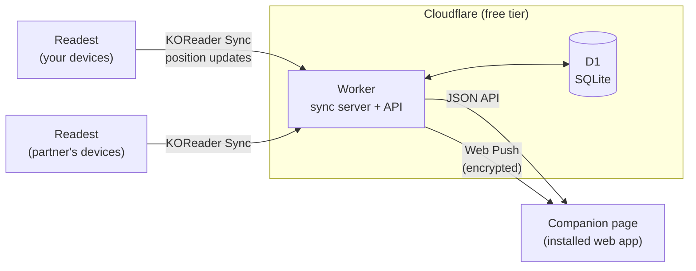

<p align="center">
  
</p>

<h1 align="center">coread</h1>

<p align="center">
  <strong>Reading together, apart.</strong><br>
  A tiny co-reading companion for two people, running free on Cloudflare.
</p>

<p align="center">
  
  
  
  
</p>

---

You read in [Readest](https://readest.com) on your phone, tablet or PC, as usual. coread quietly receives your reading position and turns it into a shared space for the two of you:

- **Who's reading right now.** Live presence with a ticking "page turned 12 s ago", the device, the book and how far in.
- **Shared progress.** Both progress bars for a book you're both reading, who's ahead, and a **spoiler warning** when one of you pulls too far ahead.
- **Reading habits.** Minutes per day, streaks, a when-you-read heatmap, pace, and time spent reading *at the same moment*.
- **Shelves.** A tiny private Goodreads for two: currently reading, want to read, finished (with ratings and notes), paused. Your partner's note on a book stays hidden until you've finished it too.
- **Notifications.** Straight to your phone, no extra app:

  > 📖 Sam started reading *The Drug Hunters*<br>
  > ✅ Sam finished section 11<br>
  > 💞 You're both reading right now<br>
  > 🛑 Spoiler zone: you're 7% ahead. Careful what you say!<br>
  > 🎉 Sam finished the book. Time to talk about the ending.<br>
  > 👋 Sam wants to read together<br>
  > 📊 Weekly recap, every Sunday evening

It's built for exactly two people, typically a couple in a long-distance relationship. Each of you keeps your own login, so your own phone and PC still sync with each other.

## Contents

- [What's on the page](#whats-on-the-page)
- [How it works](#how-it-works)
- [Set it up](#set-it-up)
- [Configuration](#configuration)
- [Development](#development)
- [Project layout](#project-layout)
- [Privacy and security](#privacy-and-security)
- [Known limits](#known-limits)

## What's on the page

The companion page installs to your home screen like an app, follows your light or dark mode, and refreshes live.

| Tab | What you see |
|---|---|
| **Now** | Both of you: reading now or last seen, on which device, which book. Then your current books with both progress bars, the gap between you, time left, and time per section. |
| **Habits** | A side-by-side comparison (today, this week, streak, sessions, time per page, pace, time together), minutes read per day for the last 14 days, and a heatmap of when you read. |
| **Sessions** | Every reading session from both of you. Tap one to see your position in the book minute by minute, seconds per page, and any jumps. |
| **Activity** | A quiet feed: new books, finished sections, ratings, nudges, weekly recaps. |
| **Shelves** | Your shelves and your partner's, with ratings, notes and a want-to-read list. |

## How it works



coread speaks the **KOReader Sync** protocol, which Readest supports out of the box. Readest sends your position about 5 seconds after you stop on a page, and again when you leave the app. coread stores every update and works out the rest:

- **Sessions.** Updates less than 10 minutes apart, in the same book, on the same device, form one reading session. Two devices open at once never split or double-count your time.
- **Reading now.** A page turn in the last 5 minutes. Re-syncs that don't move your position (switching apps, an idle device) don't count.
- **Time per page.** The gap between two forward page turns. Big skips count as jumps, not reading.
- **Section.** Taken from the EPUB position. It's the book's internal file number, which is usually, but not always, the chapter.
- **Pace and time left.** Measured from your own recent sessions.
- **Finished.** Reaching 99.5% marks a book finished automatically. You can also mark it by hand, put a book down, or send it back to reading.

Everything is one Cloudflare Worker and one D1 database. There are no other services to run.

## Set it up

About 20 minutes, once. You'll need **Node 20+**, a free **Cloudflare account**, and **Readest** on each device you read on.

### 1. Deploy

```bash
git clone https://github.com/NFRohan/coread.git
cd coread
npm install
npx wrangler login     # opens the browser once
npx wrangler deploy    # creates the Worker and its D1 database, and prints your URL
npm run db:migrate     # creates the tables
```

### 2. Add your secrets

```bash
npx wrangler secret put USERS
```

Paste one line listing the two of you. `username` is what you'll type into Readest (case-sensitive), `name` is what the page shows:

```json
[{"username":"rohan","name":"Rohan"},{"username":"sam","name":"Sam"}]
```

If you live in different time zones, add `"tz":"Europe/London"` (any IANA zone) to a person. Otherwise everyone uses `TIMEZONE` from `wrangler.jsonc`.

```bash
npx wrangler secret put SESSION_SECRET      # any long random string (signs login cookies)

npm run vapid                               # prints a Web Push key pair
npx wrangler secret put VAPID_PUBLIC_KEY    # paste the first value
npx wrangler secret put VAPID_PRIVATE_KEY   # paste the second value
npx wrangler secret put VAPID_SUBJECT       # optional: your Worker URL or a mailto: address
```

> [!IMPORTANT]
> Keep the VAPID key pair once it's set. Replacing it means every device has to turn notifications on again.

Your coread is now at `https://coread.<your-subdomain>.workers.dev`. Only the usernames in `USERS` can ever register.

### 3. Connect Readest (on every phone, tablet and PC)

In Readest, open **Settings → Integrations → KOReader Sync**:

| Field | Value |
|---|---|
| Server URL | `https://coread.<your-subdomain>.workers.dev` |
| Username / Password | **your own**. The first *Connect* creates your account; use the same password on every device. |
| Send Document Metadata | **On**, so book titles and covers appear |
| Device Name | `Phone`, `Tablet` or `PC`, so the right icon shows |
| Sync Strategy | *Ask on conflict*, or *Always use latest* to jump to your newest page silently |

> [!TIP]
> **Reading the same book? Share the exact EPUB file.** Readest identifies a book by its file contents, so two separately downloaded copies count as two different books.

### 4. Open the page and turn on notifications

1. Open your Worker URL and sign in with your Readest username and password.
2. Install it: in Chrome on Android, **⋮ → Add to home screen**. On a PC, use the install icon in the address bar.
3. Go to **Settings → Notifications → Turn on notifications**, then **Send a test notification**.

Do step 3 on every device where you want notifications. You're notified about your partner's reading, not your own.

## Configuration

| Where | Setting | Default |
|---|---|---|
| `wrangler.jsonc` → `vars` | `TIMEZONE`: day boundaries for stats | `Asia/Dhaka` |
| | `SPOILER_GAP`: how far ahead triggers the spoiler guard | `0.05` (5%) |
| `wrangler.jsonc` → `triggers` | Weekly recap schedule (cron, UTC) | Sundays 15:00 UTC |
| `src/config.ts` | Session gap, "reading now" window | 10 min, 5 min |
| `src/track.ts` | Break before "started reading" is announced, cooldown on "reading together" | 45 min, 2 h |
| `src/library.ts` | Auto-finish threshold, "paused" after | 99.5%, 21 days |

After changing `wrangler.jsonc`, run `npm run types` and then `npx wrangler deploy`.

## Development

```bash
cp .dev.vars.example .dev.vars   # then run `npm run vapid` and paste the keys in
npm run dev:test                 # local D1 + wrangler dev on :8787
npm run test:smoke               # in a second terminal
npm run check                    # TypeScript
```

Locally, notifications are encrypted exactly as in production but logged instead of sent, and tests can control the clock with an `X-Coread-Now` header.

The smoke test (`test/smoke.mjs`) talks to the server exactly the way Readest does. It registers two users, simulates overlapping reading sessions, and checks:

- the sync protocol, including Readest's HTTP Basic fallback;
- presence, shared progress, the spoiler gap, stats and time read together;
- sessions across two devices, time per page and per section;
- shelves, ratings, spoiler-safe notes, and finished books leaving the Now tab;
- notifications, the nudge cooldown and Web Push subscriptions;
- cross-origin protection and the weekly recap.

To run it from a clean slate, stop the dev server and delete `.wrangler/state`.

## Project layout

```
src/
  index.ts      router: KOReader Sync endpoints, page API, weekly cron
  track.ts      folds each position update into a session; decides what to notify
  stats.ts      everything the Now and Habits tabs show
  detail.ts     session timelines, time per page and per section, live presence
  library.ts    shelves: status, ratings, notes, want-to-read
  notify.ts     activity feed + sending notifications
  webpush.ts    Web Push encryption (RFC 8291) and VAPID signing (RFC 8292), WebCrypto only
  covers.ts     cover lookup on Open Library
  auth.ts       sync-protocol auth and signed session cookies
  config.ts     USERS, time, small helpers
public/         the companion page: HTML, one CSS file, vanilla JS, service worker
migrations/     D1 schema, applied in order
test/smoke.mjs  end-to-end test
docs/           design brief for the visual layer
```

There are no runtime dependencies. The page has no framework and no build step, and the charts are hand-drawn SVG.

## Privacy and security

- **Your data stays in your Cloudflare account.** There's no third-party analytics and no tracking.
- **Passwords:** Readest sends an MD5 of your password, as the KOReader Sync protocol requires. coread stores only a salted SHA-256 of that, and the page's login cookie is HMAC-signed and HttpOnly.
- **Notifications** are end-to-end encrypted with Web Push. The browser's push service (Google's for Chrome, Mozilla's for Firefox) delivers them but can't read them.
- **Book covers** are looked up on Open Library by title and author, which is the only outside request coread makes about your books.
- **Registration is closed** to anyone not listed in `USERS`. API calls that change data must come from the page's own origin.

## Known limits

- **Two people.** The page, colours and "together" stats assume exactly two readers.
- **Readest only (tested).** Other KOReader Sync clients may work but haven't been tried.
- **Sections aren't always chapters.** Some EPUBs split a chapter across several files, or put the cover and contents first.
- **Pace and time left** appear after a few sessions of at least 3 minutes.
- **On iPhone**, notifications only work once coread has been added to the home screen.
- **Nothing appears inside Readest itself.** That would need a Readest fork; the page and notifications are the co-reading layer.
